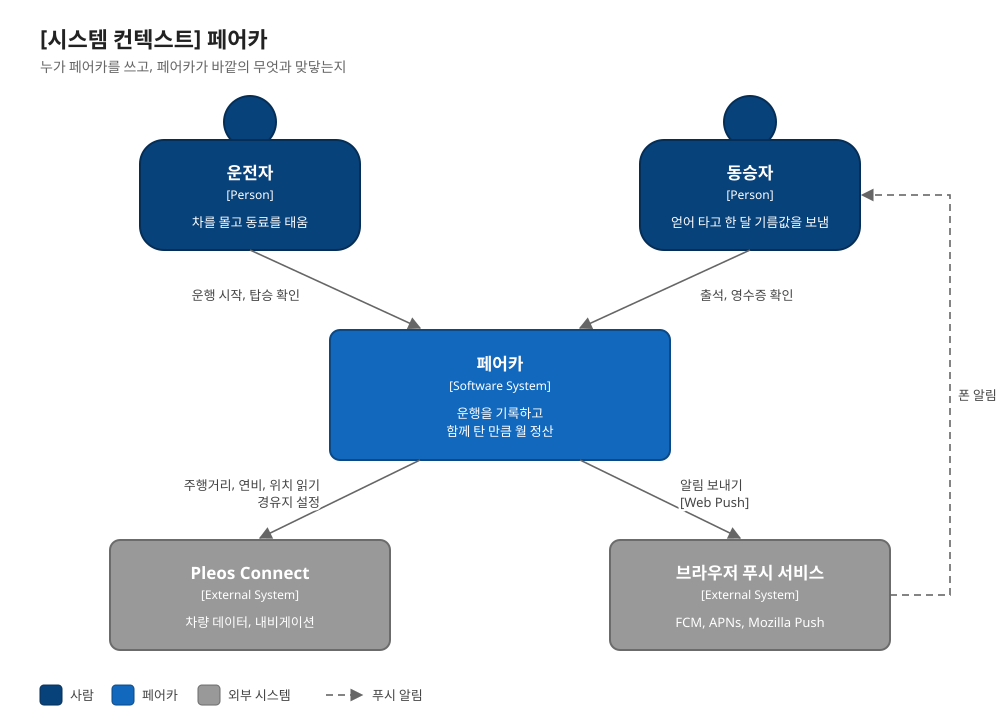
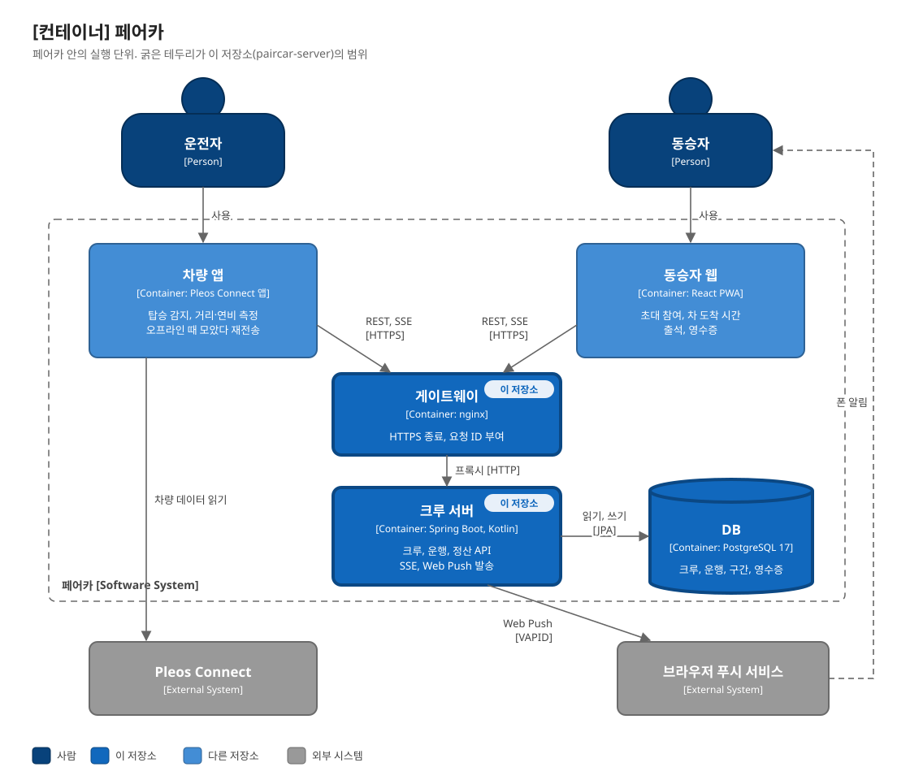
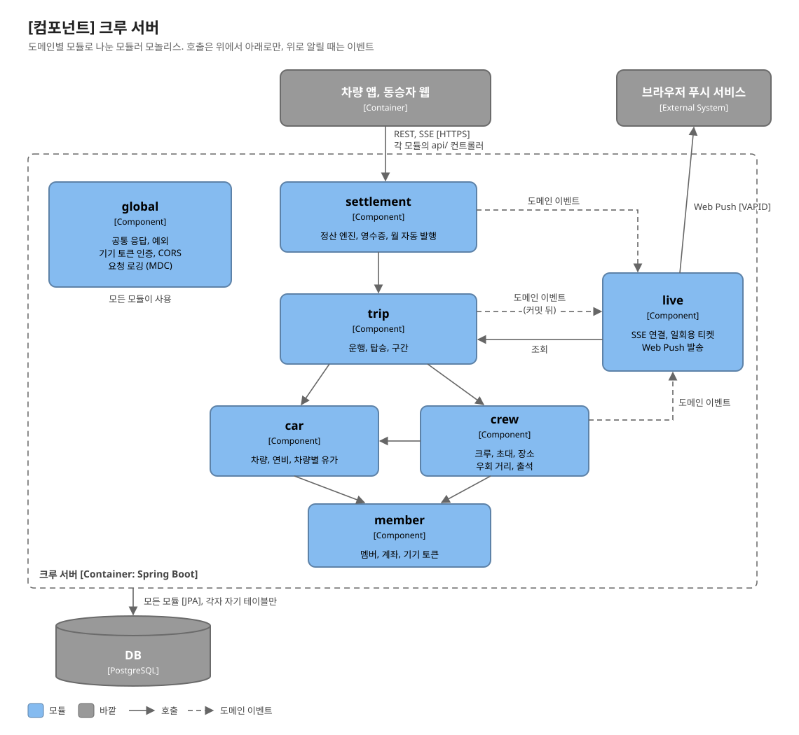

<h1 align="center">PairCar Server (페어카 크루 서버)</h1>

<p align="center">
  <b>차가 실제로 달린 거리로, 함께 탄 만큼만 나눕니다.</b><br/>
  카풀 비용을 "대충 N빵"이 아니라 구간별 실측으로 정산하는 크루 서버
</p>

<p align="center">
  
  
  
  
  
  
  
  
  
</p>

<p align="center">
  <a href="https://github.com/hyundai-full-accel/paircar-vehicle">차량 앱</a> ·
  <a href="https://github.com/hyundai-full-accel/paircar-mobile">동승자 웹</a> ·
  <a href="docs/architecture.md">아키텍처</a> ·
  <a href="docs/sequences.md">핵심 시퀀스</a>
</p>

---

## 소개

같은 단지 동료를 태우고 출근하면, 기름값은 얼마를 받아야 할까요?
"그냥 N빵"은 중간에 내리는 사람, 나를 태우러 돌아가는 거리, 통행료를 반영하지 못합니다. 그래서 대부분은 애매하게 넘어가고, 그게 쌓여 카풀이 깨집니다.

**페어카**는 현대자동차그룹 차량용 앱 개발 공모전(Pleos Connect) 출품작입니다. 차량 앱이 실제로 달린 거리와 연비, 누가 어디서 타고 내렸는지를 기록하고, 이 서버가 그 기록으로 한 달 정산 영수증을 만듭니다.

이 저장소는 세 부분 중 **크루 서버**입니다.

| 구성 | 역할 | 저장소 |
|---|---|---|
| 차량 앱 | Pleos Connect 인포테인먼트에서 실행. 탑승 감지, 주행거리와 연비 측정, 경유지 설정, TTS | [paircar-vehicle](https://github.com/hyundai-full-accel/paircar-vehicle) |
| **크루 서버** | 크루, 운행 기록, 월 정산, 실시간 알림 | 이 저장소 |
| 동승자 웹 | 설치 없이 초대 링크로 참여. 차 도착 시간, 지각·불참 알림, 영수증 | [paircar-mobile](https://github.com/hyundai-full-accel/paircar-mobile) |

## 아키텍처

[C4 모델](https://c4model.com)의 세 단계로 나눠 봅니다. 바깥에서 안으로 갈수록 자세해집니다.

### Level 1 · 시스템 컨텍스트

누가 페어카를 쓰고, 페어카가 바깥의 무엇과 맞닿는지입니다.

<p align="center"></p>

### Level 2 · 컨테이너

페어카 안의 실행 단위입니다. 이 저장소는 **크루 서버**, **nginx**, **DB**를 맡습니다.

<p align="center"></p>

### Level 3 · 컴포넌트 (크루 서버)

크루 서버 안은 도메인별 모듈로 나눈 **모듈러 모놀리스**입니다.

<p align="center"></p>

- **실선은 호출, 위에서 아래로만.** 다른 모듈의 데이터는 그 모듈의 서비스 인터페이스로만 읽고, 리포지토리를 직접 쓰지 않습니다.
- **점선은 도메인 이벤트.** 운행이 시작되면 `trip`은 이벤트만 발행하고, `live`가 커밋 뒤에 받아 알림을 보냅니다. 롤백된 변경은 알리지 않고, `trip`은 `live`를 모릅니다.
- 그림은 [docs/images/generate_c4.py](docs/images/generate_c4.py)로 만듭니다. 고친 뒤 `python3 docs/images/generate_c4.py docs/images`로 다시 생성합니다.
- Level 4(코드)는 [docs/architecture.md](docs/architecture.md)와 [docs/schema.dbml](docs/schema.dbml)에 있습니다.

### 왜 이렇게 만들었나

| 결정 | 이유 |
|---|---|
| 모듈러 모놀리스 | 서비스 하나, DB 하나로 배포와 운영을 단순하게. 모듈 경계는 지켜 두어 나중에 떼어 낼 수 있게 |
| 로그인 없이 기기 토큰 | 동승자는 앱 설치나 회원가입 없이 초대 링크만으로 참여. 토큰은 응답에서 한 번만 주고 DB에는 SHA-256 해시만 저장 |
| WebSocket 대신 SSE + Web Push | 서버에서 클라이언트로 가는 알림만 필요. 웹이 닫혀 있을 때는 Web Push(VAPID)로 폰에 알림. FCM SDK나 별도 계정 없이 브라우저 표준만 씀 |
| SSE에 일회용 티켓 | 브라우저 `EventSource`는 인증 헤더를 못 붙임. 토큰으로 60초짜리 티켓을 받아 구독 주소에는 티켓만 넣음 (토큰이 URL과 로그에 남지 않게) |
| 같은 요청이 와도 결과가 같게 | 차량은 터널이나 지하에서 통신이 끊김. 차량 앱이 모아 뒀다 다시 보내도 탑승, 하차, 구간, 종료가 두 번 기록되지 않음 |
| 영수증은 발행 뒤 고정 | 계좌, 연비, 유가를 발행 시점 값으로 저장. 이상한 기록은 고치지 않고 "기록 확인 요청"으로 운전자에게 물음 |

## 정산 알고리즘

공모전 기획서 별지 기술명세 T5의 구간 기반 정산(FAIR)을 따릅니다. 운행 하나를 **탑승 인원이 바뀌는 지점마다 구간으로 나누고**, 구간마다 그 구간에 탄 사람끼리만 나눕니다.

```
km당 비용     = 월평균 유가 ÷ 연비
구간 분담     = Σ (구간 거리 × km당 비용 ÷ 구간 탑승 인원)      운전자 포함 여부는 크루 설정
우회 비용     = 둘 다 확인한 우회 거리 × km당 비용                나를 태우러 더 달린 거리는 내가 냄
통행료 분담   = 운행 통행료 ÷ 운행 탑승 인원
한 달 금액    = 위 합계를 100원 단위로 올림
```

**예시** (기획서 시나리오, 테스트로 검증): 18일 탑승, 함께 탄 거리 216km(운전자와 둘), 우회 3km × 18일, 연비 13.2km/L, 유가 1,684원/L

```
내 부담 거리  216 ÷ 2 + 54 = 162km
유류비       162 × 1,684 ÷ 13.2 = 20,667원
보낼 금액     100원 단위 올림 → 20,700원
```

- **유가:** 운행에 쓴 차량에 직접 넣은 단가(예: 전기차 집 충전 단가)를 먼저 쓰고, 없으면 연료별 공공 월평균을 씁니다.
- **우회 거리:** 운전자와 동승자가 둘 다 확인한 값만 씁니다.
- **발행:** 매달 1일 04:00(KST)에 지난달 영수증을 자동으로 발행합니다. 영수증이 나온 뒤에 늦게 올라온 탑승은 다음 달로 넘어갑니다.

## API

전체 요청, 응답 형식은 서버 실행 후 **`/swagger-ui.html`** 에 있습니다. 주요 흐름만 정리하면 다음과 같습니다.

| 영역 | 메서드 · 경로 | 설명 |
|---|---|---|
| 멤버 | `POST /api/members` | 멤버 생성, 기기 토큰 발급 (응답에서 한 번만) |
| 초대 | `GET /api/invites/{code}` | 초대 미리보기 (토큰 없이) |
| | `POST /api/invites/{code}/members` | 처음 온 동승자 참여 |
| 크루 | `POST` `GET` `PUT /api/crews/...` | 크루 생성, 조회, 일정과 정산 방식 설정 |
| | `PUT /api/crews/{id}/members/{id}/places` | 평소 탈 곳, 내릴 곳, 픽업 시각 |
| | `GET` `PUT .../attendance/{date}` | 그날 출석 (안 타요, 그날만 다른 곳, 지각) |
| 운행 | `POST /api/trips` | 운행 시작 (응답의 경유지로 내비 설정) |
| | `POST /api/trips/{id}/boardings/{id}/board` `/alight` | 탑승, 하차 기록 |
| | `POST /api/trips/{id}/segments` `/end` | 구간 업로드, 운행 종료 |
| | `GET /api/crews/{id}/trips/current` `?month=` | 진행 중인 운행, 월 운행 목록 |
| 실시간 | `POST /api/trips/{id}/live/location` | 차 위치, 동승자별 남은 시간 |
| | `POST /api/live/tickets` → `GET /api/live/events` | SSE 구독 (일회용 티켓) |
| | `PUT /api/push/subscriptions` | Web Push 구독 |
| 정산 | `GET /api/crews/{id}/receipts?month=` | 월 영수증 |
| | `POST /api/receipts/{id}/inquiries` | 기록 확인 요청 |

응답은 모두 `{ "success", "data", "error": { "code", "message", "fieldErrors" } }` 형식이고, 클라이언트는 `error.code`로 분기합니다.

## 기술 스택

| 영역 | 기술 |
|---|---|
| 언어, 런타임 | Kotlin 2.2, Java 21 |
| 프레임워크 | Spring Boot 3.5 (Web MVC, Data JPA, Validation) |
| DB, 마이그레이션 | PostgreSQL 17, Flyway |
| 실시간 | SSE (`SseEmitter`), Web Push (VAPID, `nl.martijndwars:web-push`) |
| API 문서 | springdoc-openapi (Swagger UI) |
| 테스트 | JUnit 5, MockMvc, Testcontainers (PostgreSQL) |
| 빌드, 배포 | Gradle 9.8, Docker (멀티 스테이지 이미지), Docker Compose, nginx, Let's Encrypt |
| 로깅 | 요청마다 `X-Request-Id`, 모든 로그 줄에 `[req=… m=멤버ID]` (MDC) |

## 시작하기

필요한 것: **JDK 21**, **Docker**

### 코드를 고치면서 개발할 때

```bash
./gradlew bootRun
```

`spring-boot-docker-compose`가 PostgreSQL(`infra/compose.local.yaml`)을 자동으로 띄웁니다. 서버는 `http://localhost:8080`, Swagger는 `http://localhost:8080/swagger-ui.html`입니다.

### 실제 배포와 같은 구성 (nginx + 서버 + DB)

```bash
cp infra/.env.example infra/.env
docker compose -f infra/compose.yaml up -d --build --wait
```

`http://localhost`로 열립니다. HTTPS 배포와 인증서 발급은 [infra/README.md](infra/README.md)에 있습니다.

### 테스트

```bash
./gradlew test
```

Testcontainers가 실제 PostgreSQL을 띄우므로 Docker가 실행 중이어야 합니다. Flyway 마이그레이션까지 그대로 돌고, 테스트의 "오늘"은 2027-01-15로 고정되어 언제 돌려도 결과가 같습니다.

테스트를 돌리면 `build/openapi.json`에 API 명세가 나옵니다. 동승자 웹은 서버를 띄우지 않고 이 파일로 API 타입을 만듭니다(`paircar-mobile`: `npm run gen:api`).

### 설정

`infra/.env`의 주요 값입니다. 전체 목록은 [infra/README.md](infra/README.md#환경변수)에 있습니다.

| 이름 | 기본값 | 설명 |
|---|---|---|
| `POSTGRES_PASSWORD` | (필수) | DB 비밀번호 |
| `PAIRCAR_CORS_ALLOWED_ORIGINS` | `http://localhost:3000` | 동승자 웹 주소. 이 출처만 브라우저에서 API를 부를 수 있음 |
| `PAIRCAR_INVITE_BASE_URL` | `http://localhost:3000/join` | 초대 링크, QR에 들어가는 동승자 웹 주소 |
| `PAIRCAR_VAPID_PUBLIC_KEY` `PAIRCAR_VAPID_PRIVATE_KEY` | (비어 있음) | Web Push 키. 비우면 폰 알림만 꺼지고 SSE는 그대로 |
| `DOMAIN` `CERTBOT_EMAIL` | (비어 있음) | HTTPS 배포 때 인증서를 받을 도메인과 알림 메일 |

## 프로젝트 구조

```
src/main/kotlin/com/fullaccel/paircarserver/
├─ member/       멤버, 계좌, 기기 토큰
├─ car/          차량, 차량별 유가와 연비
├─ crew/         크루, 초대, 장소, 우회 거리, 출석, 정산 기준 동의
├─ trip/         운행, 탑승, 구간 (오프라인 재전송에도 결과가 같게)
├─ settlement/   정산 엔진, 영수증, 월 자동 발행, 기록 확인 요청
│  └─ calculator/   순수 계산 (DB 없이 단위 테스트)
├─ live/         SSE, Web Push, 실시간 이벤트 (다른 모듈은 live를 모름)
└─ global/       공통 응답, 예외, 인증 리졸버, CORS, 요청 로깅

모듈 안은 api/ (컨트롤러, 요청 DTO) · application/ (서비스 인터페이스와 구현, 이벤트) · domain/ (엔티티, 리포지토리)

src/main/resources/db/migration/   Flyway 마이그레이션 (V1~)
infra/                             Dockerfile, compose, nginx, HTTPS
docs/                              아키텍처, 핵심 시퀀스, 데이터 모델
```

## 문서

| 문서 | 내용 |
|---|---|
| [docs/architecture.md](docs/architecture.md) | 전체 구성, 모듈 규칙, 인증과 권한, 서버 안의 흐름, 확장 지점 |
| [docs/sequences.md](docs/sequences.md) | 처음 설정, 초대와 참여, 출근 한 번, 예외 상황, 오프라인 재전송, 월말 정산 시퀀스 |
| [docs/schema.dbml](docs/schema.dbml) | 데이터 모델 ([dbdiagram.io](https://dbdiagram.io)에서 열람) |
| [infra/README.md](infra/README.md) | 로컬 실행, HTTPS 배포, 인증서 갱신, 환경변수 |
| `/swagger-ui.html` | API 명세 (서버 실행 후) |

## 팀

**[hyundai-full-accel](https://github.com/hyundai-full-accel)** · 현대자동차그룹 차량용 앱 개발 공모전 (Pleos Connect)
