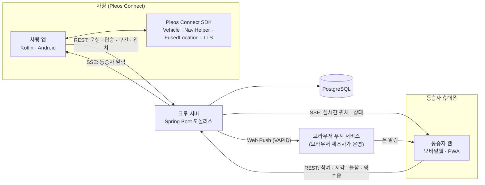
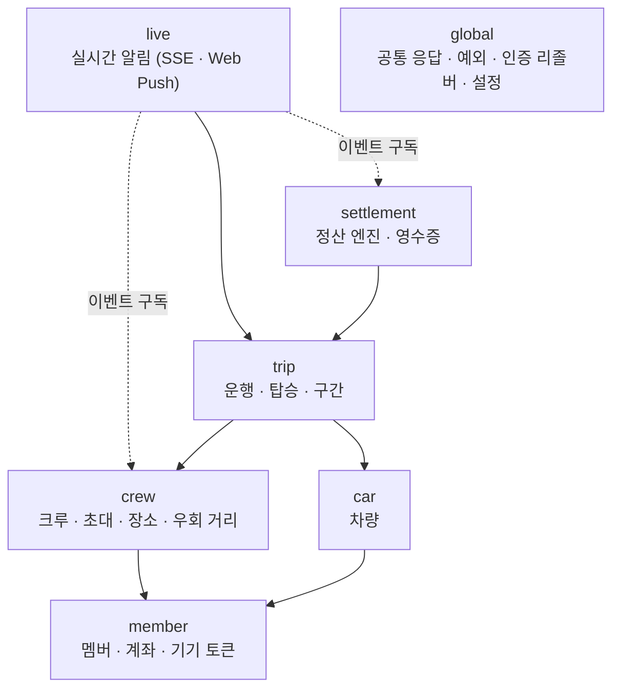
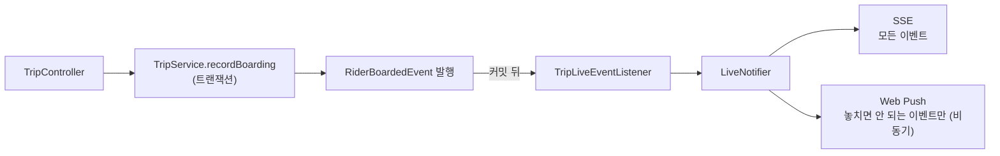
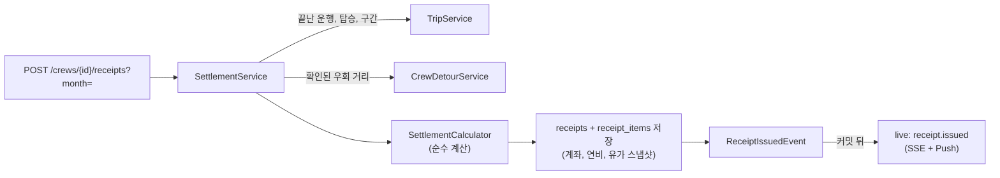

# 페어카 아키텍처

페어카는 차량 앱, 동승자 웹, 크루 서버 세 부분으로 이루어집니다. 이 문서는 전체 구성과 크루 서버(이 저장소)의 내부 구조를 설명합니다.

- 데이터 모델: [schema.dbml](schema.dbml)
- 핵심 시퀀스: [sequences.md](sequences.md)
- API 명세: 서버 실행 후 `/swagger-ui.html`

## 1. 전체 구성



| 구성 | 맡는 일 |
|---|---|
| 차량 앱 | 탑승 판단(위치 → 도어 → 벨트 상태 머신), 경유지 설정·삭제, 거리·연비 측정, TTS, 오프라인 버퍼 |
| 크루 서버 | 크루·장소·운행 저장, 정산 계산, 실시간 이벤트 분배, 인증 |
| 동승자 웹 | 초대 링크로 참여, 남은 시간 지도, 지각·불참 버튼, 영수증 확인 |

원칙 (기획서 별지 T1)

- 차량 앱이 기준 데이터를 만듭니다. 거리, 연비, 탑승 여부는 차량에서 측정하고, 서버와 동승자 웹은 저장, 계산, 표시만 합니다.
- 차량 앱과 동승자 웹은 서로 직접 통신하지 않습니다. 모든 메시지는 서버를 거칩니다.
- 탑승 판단과 경유지 삭제는 서버 없이 차량 안에서 처리합니다. 통신이 끊겨도 기록을 차량에 저장했다가 연결되면 순서대로 보냅니다.

### 통신 방식

| 방향 | 방식 | 이유 |
|---|---|---|
| 클라이언트 → 서버 | REST | 요청과 응답이 1:1. 재전송해도 결과가 같도록(멱등) 설계 |
| 서버 → 열려 있는 클라이언트 | SSE | 서버에서 내려보내기만 하면 됨. 끊기면 다시 연결 |
| 서버 → 닫혀 있는 동승자 웹 | Web Push | 놓치면 안 되는 알림(출발, 곧 도착, 차 도착, 영수증) |

Web Push는 웹 표준(VAPID, RFC 8030·8291·8292)을 그대로 씁니다. Firebase 프로젝트나 FCM 키는 필요 없습니다. 브라우저가 구독할 때 자기 제조사의 푸시 서비스 주소(endpoint)를 주고, 서버는 그 주소로 암호화된 메시지를 보냅니다. 서버에 필요한 설정은 VAPID 키 한 쌍뿐입니다.

### 인증

로그인 화면 없이 기기 토큰으로 멤버를 구분합니다. 호출 순서는 [sequences.md 1~3](sequences.md#1-처음-설정-운전자)에 있습니다.

| 항목 | 설계 |
|---|---|
| 기기 토큰 | 멤버 생성, 초대 참여 때 발급. 원문은 응답에서 한 번만 주고 DB에는 SHA-256 해시만 저장. 180일 유효 |
| 초대 코드 | 헷갈리는 글자(0, 1, I, L, O)를 뺀 8자. 7일 뒤 만료. 입력할 때 대소문자, 하이픈 무시. 링크 주소는 환경변수로 설정 |
| SSE 구독 | 브라우저 `EventSource`는 인증 헤더를 붙일 수 없어서, 토큰으로 60초짜리 일회용 티켓을 받고 구독 URL에는 티켓만 넣음 (토큰이 URL, 로그에 남지 않도록) |

## 2. 크루 서버: 모듈러 모놀리스

배포 단위는 하나(Spring Boot 1개, PostgreSQL 1개)이고, 안쪽은 도메인 모듈로 나눕니다.



실선은 서비스 호출, 점선은 도메인 이벤트 구독입니다. 모든 모듈은 `global`을 씁니다(그림에서는 생략).

### 모듈 사이 규칙

1. **의존은 위에서 아래로만 흐릅니다.** 순환 의존이 없고, `live`를 import하는 모듈은 없습니다.
2. **다른 모듈의 데이터는 그 모듈의 서비스 인터페이스로만 읽습니다.** 다른 모듈의 리포지토리를 직접 쓰지 않습니다. 예를 들어 정산은 `TripService.getSettlementTrips`로만 운행 데이터를 읽습니다.
3. **아래 모듈이 위 모듈에 알려야 할 때는 도메인 이벤트를 발행합니다.** 받는 쪽은 트랜잭션 커밋 뒤에 처리하므로, 롤백된 변경은 알리지 않습니다.
4. **`global`은 도메인을 모릅니다.** 토큰 인증도 `TokenAuthenticator` 인터페이스만 `global`에 두고 구현은 `member`에 있습니다.

### 모듈 안의 계층

모든 모듈이 같은 모양입니다.

```
{module}/
├── api/              Controller, 요청 DTO (@Valid)          HTTP 경계
├── application/      Service 인터페이스 + Impl, 결과 DTO     유스케이스, 트랜잭션
│   └── event/        이 모듈이 발행하는 도메인 이벤트
└── domain/           Entity, Repository                    저장
```

예외

- `settlement/calculator`: 기획서 T5 정산 규칙을 담은 순수 Kotlin 코드입니다. Spring과 DB에 의존하지 않습니다.
- `live/sse`, `live/push`: 외부 채널 구현입니다. `application`의 인터페이스(`LiveEventSender`, `PushSender`)를 구현합니다.

### 공통 처리 (global)

| 항목 | 내용 |
|---|---|
| 응답 형식 | 성공 `{ success: true, data }`, 실패 `{ success: false, error: { code, message, fieldErrors } }` |
| 예외 | 서비스는 `BusinessException(ErrorCode)`를 던지고, 전역 핸들러가 HTTP 상태와 코드로 바꿉니다 |
| 인증 | 컨트롤러 파라미터의 `@LoginMember`가 Bearer 토큰을 멤버 ID로 바꿉니다 |
| 시간 | 저장은 UTC, 운행일과 정산 월은 KST |

## 3. 서버 안의 흐름

클라이언트와 오가는 호출 순서는 [sequences.md](sequences.md)에 있습니다. 여기서는 요청 하나가 서버 모듈 사이를 어떻게 지나가는지만 다룹니다.

### 도메인 이벤트에서 알림까지

탑승 기록을 예로 들면 다음과 같습니다.



- `trip`은 `live`를 모릅니다. 알림 채널을 바꾸거나 늘려도 운행 코드는 바뀌지 않습니다.
- 같은 요청이 다시 와도(오프라인 버퍼 재전송) 상태가 실제로 바뀔 때만 이벤트가 나갑니다.

### 월말 정산



- 정산은 다른 모듈의 리포지토리를 쓰지 않고, `TripService`, `CrewDetourService`가 주는 데이터만 받습니다.
- 계산은 `SettlementCalculator`에 모여 있어서 DB 없이 단위 테스트합니다.

## 4. 데이터

- PostgreSQL 하나를 씁니다. 테이블은 각 모듈이 소유하고, 모듈 사이 FK는 의존 방향과 같은 방향으로만 걸립니다.
- `push_subscriptions`는 알림 채널 데이터라 멤버 엔티티와 연관관계를 맺지 않고 `member_id` 값만 가집니다.
- 영수증의 계좌, 연비, 유가, 우회 거리는 발행 시점의 스냅샷입니다. 원본이 바뀌어도 지난 정산은 그대로입니다.
- 실시간 위치, SSE 연결, 구독 티켓은 DB에 저장하지 않고 서버 메모리에만 둡니다.

## 5. 확장 지점

| 상황 | 바꿀 곳 | 그대로인 곳 |
|---|---|---|
| 서버를 2대 이상으로 | `LiveEventSender`, 티켓 저장소를 Redis로 | 운행, 정산, 크루 코드 |
| 알림 채널 추가 (카카오 알림톡 등) | `live`에 Sender 구현을 추가하고 `LiveNotifier`에 연결 | 도메인 모듈 |
| 정산 방식 추가 (월 정액 등) | `SettlementCalculator`, `SettlementServiceImpl` | API, 운행 |
| 모듈을 별도 서버로 분리 | 엔티티 직접 참조를 ID 참조로, 서비스 호출을 HTTP로 | 모듈 경계 (이미 서비스 인터페이스와 이벤트로 나뉨) |

## 6. 기술 스택

| 영역 | 사용 |
|---|---|
| 언어, 런타임 | Kotlin 2.2, Java 21 |
| 프레임워크 | Spring Boot 3.5 (Web MVC, Data JPA, Validation) |
| DB | PostgreSQL 17 |
| API 문서 | springdoc-openapi (Swagger UI) |
| 실시간 | SSE (Spring MVC `SseEmitter`), Web Push (`nl.martijndwars:web-push`, VAPID) |
| 테스트 | JUnit 5, Testcontainers (PostgreSQL), MockMvc |
| 로컬 개발 | Docker Compose (`bootRun` 시 PostgreSQL 자동 실행) |
