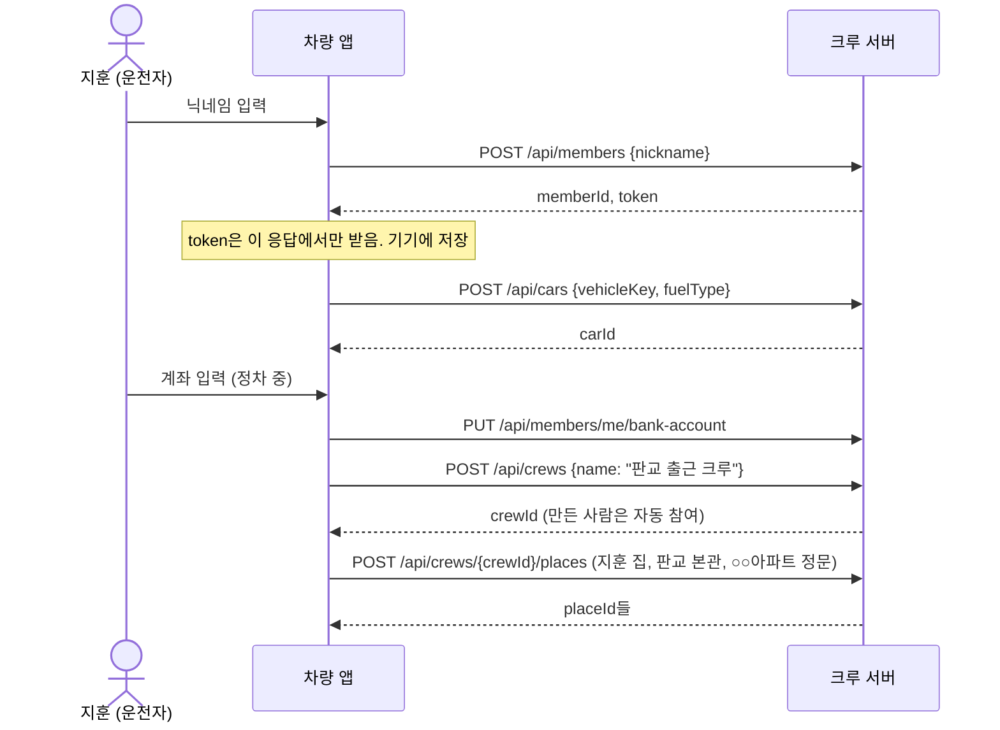
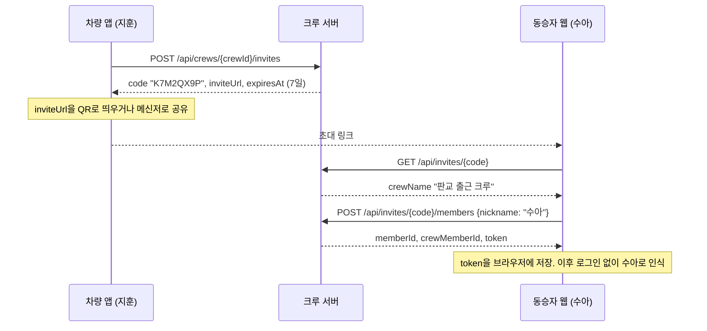
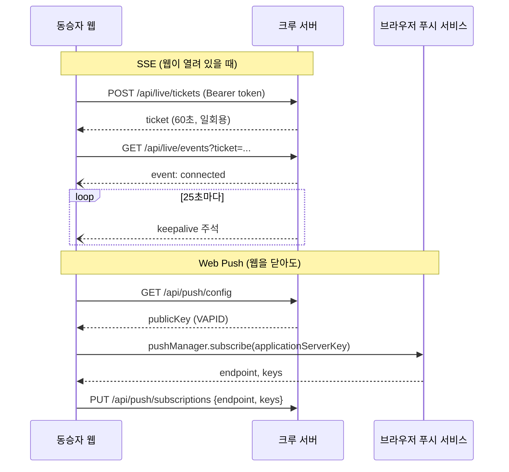
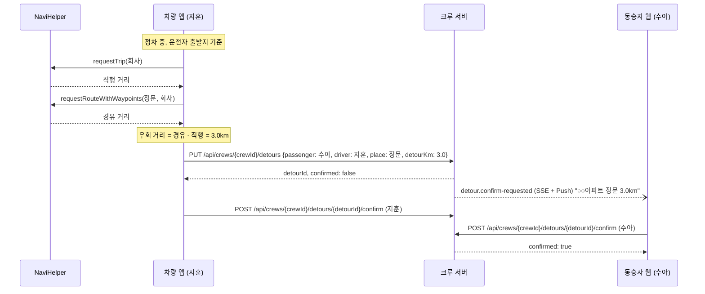
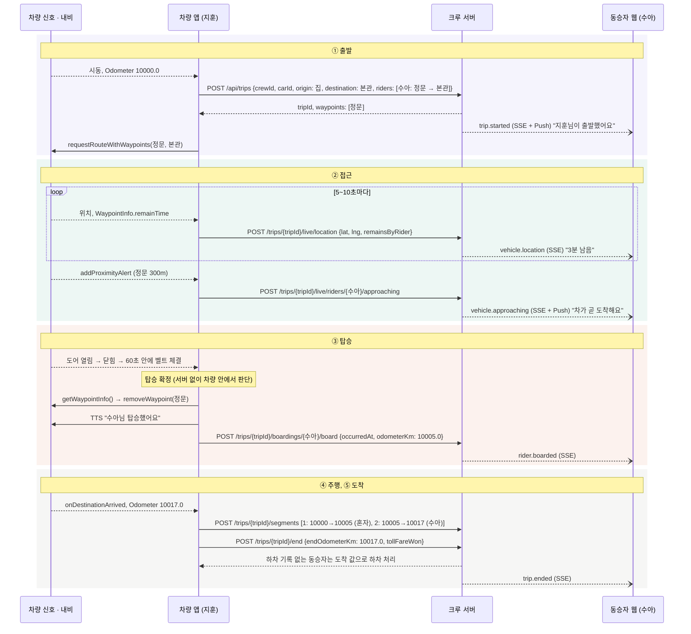
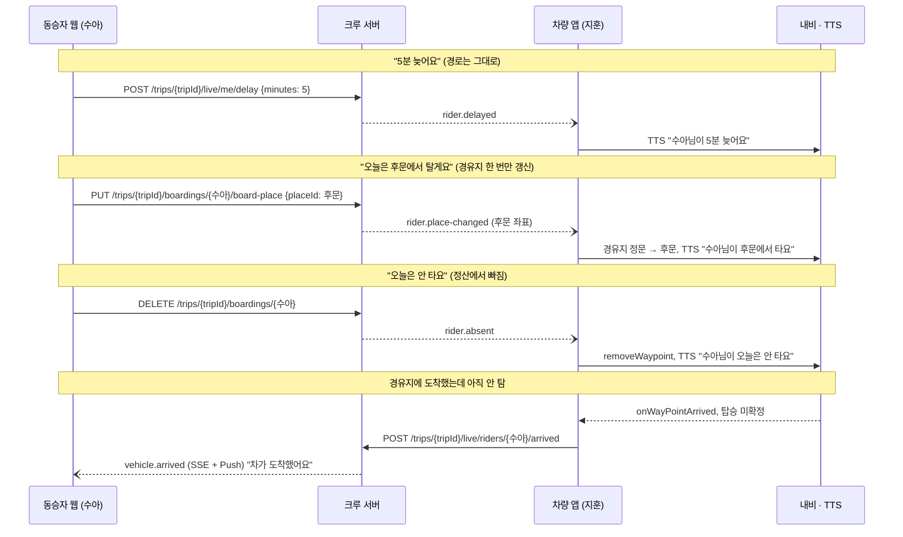
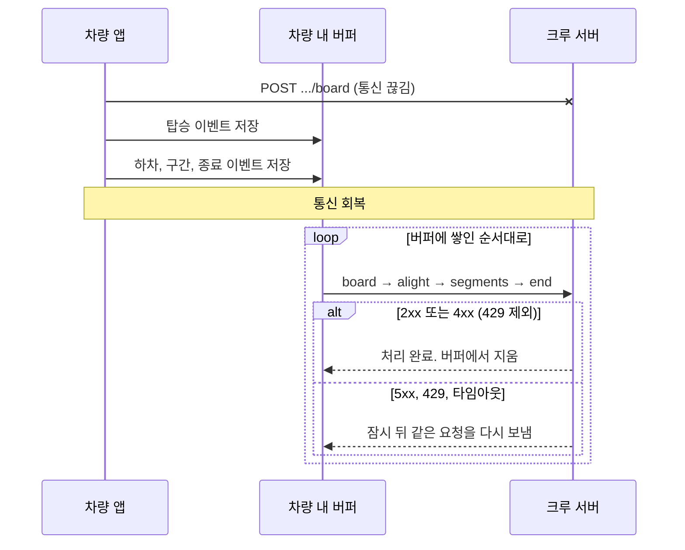
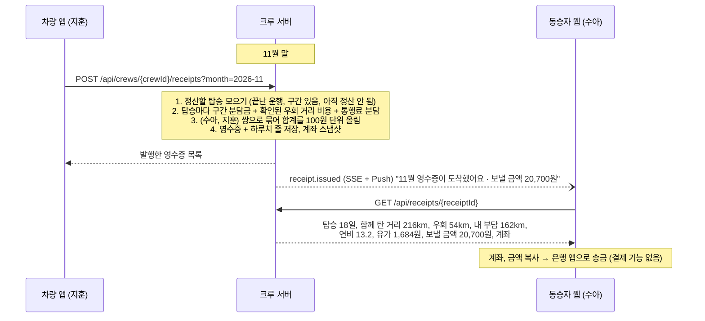

# 페어카 핵심 시퀀스

기획서 시나리오(지훈이 같은 단지 동료 수아를 태우고 판교로 출근)를 기준으로, 차량 앱, 크루 서버, 동승자 웹 사이에서 실제로 오가는 호출을 정리합니다. API 경로는 이 저장소에 구현된 그대로입니다.

- 전체 구조: [architecture.md](architecture.md)
- 요청, 응답 필드: 서버 실행 후 `/swagger-ui.html`

| # | 시퀀스 | 언제 |
|---|---|---|
| 1 | [처음 설정](#1-처음-설정-운전자) | 운전자가 차량 앱을 처음 켤 때 |
| 2 | [초대와 참여](#2-초대와-참여) | 동승자를 크루에 넣을 때 |
| 3 | [실시간 구독](#3-실시간-구독) | 앱, 웹을 열 때마다 |
| 4 | [우회 거리 산출과 확인](#4-우회-거리-산출과-확인) | 동승자가 합류한 뒤 한 번 |
| 5 | [출근 한 번](#5-출근-한-번) | 매일 아침 |
| 6 | [예외 상황](#6-예외-상황) | 지각, 불참, 지점 변경, 미탑승 |
| 7 | [오프라인 재전송](#7-오프라인-재전송) | 운행 중 통신이 끊겼을 때 |
| 8 | [월말 정산](#8-월말-정산) | 매월 말 |

표기

- `->>` 요청, `-->>` 응답, `--)` 서버가 먼저 보내는 알림(SSE 또는 Web Push)
- "SSE"는 앱, 웹이 열려 있을 때만, "Push"는 웹을 닫아도 받습니다. 채널과 인증 설계는 [architecture.md](architecture.md#통신-방식)에 있습니다.

---

## 1. 처음 설정 (운전자)

- 계좌가 없으면 운행을 시작할 수 없습니다(`BANK_ACCOUNT_REQUIRED`). 영수증에 넣을 계좌이기 때문입니다.
- 같은 `vehicleKey`로 다른 멤버(가족 등)가 등록하면 같은 차량에 연결됩니다.

## 2. 초대와 참여

- 이미 토큰이 있는 멤버(다른 크루의 운전자 등)는 `POST /api/invites/{code}/join`으로 참여합니다.

## 3. 실시간 구독

- 차량 앱도 같은 방법으로 SSE를 구독해서 동승자 알림(지각, 불참 등)을 받습니다. Web Push 구독은 하지 않습니다.
- SSE가 끊기면 새 티켓을 받아 다시 구독합니다.
- iOS는 동승자 웹을 홈 화면에 추가해야 Web Push를 받을 수 있습니다.

## 4. 우회 거리 산출과 확인

기획서 별지 T4. 매일 계산하면 교통 상황에 따라 값이 흔들리므로, 합류 뒤 한 번 산출하고 양측이 확인한 값을 정산에 씁니다.

- 교대 운전이면 운전자마다 출발지가 달라서 우회 거리를 운전자별로 따로 등록합니다.
- 값이 바뀌면(Odometer 실측 보정 등) 양측 확인이 초기화되고 다시 확인 요청이 갑니다.
- 둘 다 확인하지 않은 우회 거리는 정산에 쓰지 않습니다.

## 5. 출근 한 번

기획서 4장 "매일 아침 · 출근"의 다섯 순간(출발, 접근, 탑승, 주행, 하차)입니다.

- 구간은 탑승 인원이 바뀌는 지점마다 나눕니다. 운전자 혼자 달린 구간도 올리고, 정산에서만 빠집니다.
- 퇴근길도 같은 흐름이고, 출발지가 회사, 경유지가 하차 지점이 됩니다.

## 6. 예외 상황

기획서 4장 "예외 상황" 표의 처리입니다. 동승자 요청은 서버를 거쳐 차량 앱에 SSE로 가고, 차량 앱은 TTS로만 알립니다(주행 중 운전자 조작 없음).

- 운전자가 Gleo로 "크루한테 10분 늦는다고 알려줘"라고 하면 `POST /trips/{tripId}/live/delay`로 아직 안 탄 동승자들에게 `driver.delayed`(SSE + Push)가 갑니다.
- 탈 지점 변경과 불참은 탑승 전에만 됩니다. 경유지는 최대 2곳입니다.
- 탑승 감지에 실패하면 내비게이션의 기본 경유지 통과 처리가 그대로 동작합니다. 그 동승자는 탑승 기록이 없으니 그날 정산에서 빠지고, 동승자 웹의 "탔어요" 버튼(PT 단계)으로 보완합니다.

## 7. 오프라인 재전송

터널, 지하주차장에서 통신이 끊겨도 운행 기록은 잃지 않습니다.

- 서버는 같은 요청을 여러 번 받아도 결과가 같습니다. 탑승, 하차는 처음 값을 유지하고, 이미 저장된 구간 번호는 건너뛰고, 끝난 운행의 종료 요청은 그대로 돌려줍니다.
- 4xx는 다시 보내도 같은 이유로 실패하므로 버립니다. 단 429(게이트웨이 요청 제한)는 잠시 뒤 다시 보냅니다.
- 순서가 바뀌면(종료가 하차보다 먼저 도착) 하차가 도착 값으로 대신 채워져 탄 거리가 조금 길게 잡힐 수 있습니다. 버퍼는 발생 순서대로 보내야 합니다.

## 8. 월말 정산

기획서 4장 "월말 · 정산"과 별지 T5입니다.

- 영수증은 내는 사람과 받는 사람만 볼 수 있습니다.
- 발행된 영수증은 바뀌지 않습니다. 발행 뒤에 늦게 올라온 탑승은 다음 달 영수증에 들어갑니다.
- 지금은 발행 API를 직접 호출합니다. 월말 자동 발행은 이후에 추가합니다.
